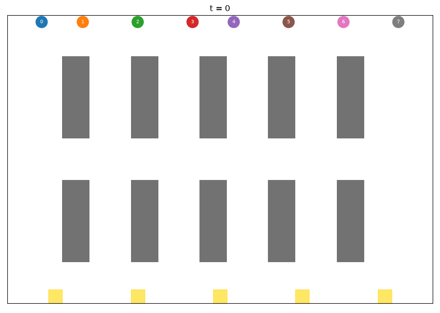

# Multi-Robot Warehouse Fleet Planner

Plans a fleet of warehouse robots that pick up orders at shelves, drop them at packing stations and return home, without colliding.

- **Task allocation:** Hungarian algorithm (optimal assignment) vs. a greedy "nearest task" baseline, using true shortest-path trip costs.
- **Path planning:** prioritized space-time A\* with a reservation table. No two robots occupy the same cell at the same time and no head-on swaps. Compared with naive independent shortest paths.
- **Output:** a results summary, `fleet_paths.png` and an animated `fleet.gif`.



## Run

```bash
python3.11 -m venv .venv && source .venv/bin/activate
pip install -r requirements.txt
python fleet_planner.py
python fleet_planner.py --robots 12 --waves 5 --seed 3   # bigger fleet
```

## Results

<!-- paste your SUMMARY lines here -->

## How it works

1. The warehouse is a 21x31 grid with five double-shelf racks. Pickup spots sit next to shelves; packing stations are on the bottom row.
2. Each wave has one order per robot. A trip costs home -> pickup -> packing station -> home, from BFS distances.
3. `scipy.optimize.linear_sum_assignment` gives the minimum-total-travel assignment.
4. Robots are planned one at a time (longest trip first) with A\* over (cell, time). Planned paths go into a reservation table that later robots must avoid. If a robot gets stuck, the order is reshuffled and planning retried.
5. Every plan is checked by simulating all robots step by step and counting same-cell and head-on conflicts.

## Limitations

- Prioritized planning is fast but not complete or optimal; conflict-based search (CBS) would be the next step.
- Grid world with unit-time moves, no robot dynamics.
